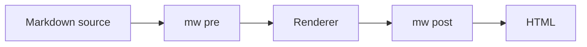

# Demo

A demonstration of all fifteen markwright extensions on a single page.

## Highlight

Inline highlight: This has a <^>highlighted word<^> in it.

In inline code: Check `config.<^>timeout<^>` for the setting.

In a code block:

```python
def process(data):
    result = <^>transform(data)<^>
    return result
```

## Fence: Labels

```python
[label app.py]
from flask import Flask

app = Flask(__name__)
```

## Fence: Secondary Labels

```
[secondary_label Output]
Server started on port 8080
```

## Fence: Environments

```
[environment local]
[label local-server.sh]
ssh user@localhost
```

```
[environment second]
[label staging-server.sh]
ssh deploy@staging.example.com
```

```
[environment third]
[label production-server.sh]
ssh deploy@prod.example.com
```

## Fence: Line Numbers

```line_numbers,python
from flask import Flask

app = Flask(__name__)

@app.route("/")
def index():
    return "Hello, World!"
```

## Fence: Command Prefix

```command
sudo apt update
sudo apt install nginx
systemctl start nginx
```

## Fence: Super User Prefix

```super_user
systemctl restart nginx
journalctl -u nginx -f
```

## Fence: Custom Prefix

```custom_prefix(mysql>)
SELECT * FROM users;
SHOW DATABASES;
USE production;
```

## Fence: Full Combination

```command
[environment local]
[label deploy.sh]
ssh root@192.168.1.1
apt update && apt upgrade -y
systemctl restart nginx
```

## YouTube

[youtube dQw4w9WgXcQ]

## CodePen

[codepen MattCowley vwPzeX dark css 300]

## Twitter

[twitter https://twitter.com/github/status/1234567890]

## Instagram

[instagram https://www.instagram.com/p/CkQuv3_LRgS caption]

## Slideshow

[slideshow https://picsum.photos/id/10/480/270 https://picsum.photos/id/20/480/270 https://picsum.photos/id/30/480/270]

## Image Compare

[compare https://picsum.photos/id/10/480/270 https://picsum.photos/id/20/480/270]

## Button

[button primary https://example.com Get Started]

[button https://example.com Read More]

## Lightbox

[lightbox https://picsum.photos/id/10/480/270 A forest path]

## Mermaid



## Icons

Build passed :lucide-check:

Rated :mw-star: :mw-star: :mw-star: by readers who :mw-heart: it.

## Grid

[grid cards 2]

[card]

**Mark Text**

Highlight a word in prose, in inline code, or inside a code block.

[/card]

[card]

**Label Code**

Add labels, environments, and `$` or `#` prompts to fenced code.

[/card]

[/grid]

## Annotate

[annotate]

```python
name = "markwright"  # (1)
debug = False  # (2)!
```

1. The package name.
2. Switches off debug output.

## Tabs

[tab Python]

Call the extensions in-process with Python-Markdown.

[/tab]

[tab CLI]

Run the same stages as a shell filter with `mw pre` and `mw post`.

[/tab]
