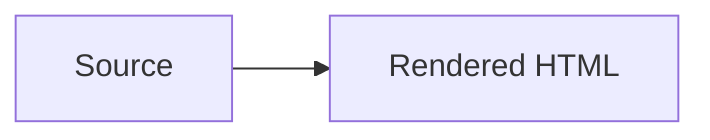
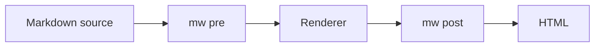

# Mermaid

Turns a fenced code block tagged `mermaid` into a `<pre class="mermaid">` element that a host script draws as a diagram.

## Usage

```python
import markdown

md = markdown.Markdown(extensions=["markwright.mermaid"])
```

See [Using with MkDocs](../integrations/mkdocs.md) to load it in a MkDocs site.

## Syntax

Tag a fence with `mermaid` and write the diagram inside:

````

````

Only a closed fence whose info string is exactly `mermaid` is converted.
An unclosed fence is not a code block, so it is left alone.
Other fences, and a mermaid fence shown inside a longer outer fence like the one above, pass through unchanged.

## HTML Contract

```html
<pre class="mermaid">graph LR
  A[Source] --&gt; B[Rendered HTML]
</pre>
```

The diagram text is HTML-escaped and placed straight inside `<pre>`, with no `<code>` wrapper.
The extension runs ahead of `pymdownx.superfences` and `markwright.fence` (preprocessor priority 45), so neither sees the block.
If your `mkdocs.yml` also has a `custom_fences` entry named `mermaid`, remove it: this extension replaces the fence first, and the entry never runs.

## Example



## Host Script

markwright ships no CSS, JavaScript, or icons.
Mermaid itself is a separate library, so the host loads and starts it.
This site does it in [`docs/javascripts/mermaid.js`](https://github.com/MasonEgger/markwright/blob/main/docs/javascripts/mermaid.js), which imports a pinned Mermaid build from a CDN and calls `mermaid.initialize({ startOnLoad: true })`.
Register it under `extra_javascript` with `type: module`.
Without a script, the reader sees the diagram source in a preformatted block.
