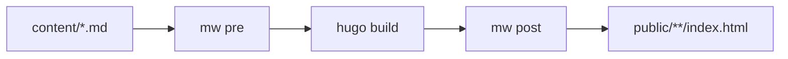

# Hugo

Hugo renders Markdown with Goldmark, not Python-Markdown, so the markwright extensions cannot run inside it.
Instead, the `mw` CLI brackets Hugo: the pre stage runs on your content before Hugo builds, and the post stage runs on Hugo's output HTML.
This is the same pre/render/post model described in the [Pipeline Guide](../pipeline.md), with Hugo as the renderer in the middle.

The `hugo.toml` settings below are the ones the project's end-to-end integration test builds with, and CI runs that test against a pinned Hugo.
The test pipes each file through `mw` and a temporary site; the commands below do the same three steps in place.

## How It Fits Together



The pre stage expands the embed, button, lightbox, mermaid, and icon directives into raw HTML, resolves prose highlights, and turns the fence, grid, card, annotate, and tab directives into marker comments.
Hugo's Goldmark renderer turns the Markdown into HTML, passing the raw HTML and the comments through.
The post stage reads the marker comments back to apply the fence labels and prefixes, the grid, card, and tab markup, and the annotation links, resolves the in-code highlights, and injects the embed scripts.

## Prerequisites

- `markwright` installed, so the `mw` command is on your path. See the [CLI Reference](../cli.md).
- A Hugo site.

## Hugo Configuration

One setting in `hugo.toml` is required, and one is recommended.
Without `unsafe = true`, Hugo replaces each raw-HTML node with `<!-- raw HTML omitted -->` and logs a `Raw HTML omitted` warning.
It drops each marker comment with no placeholder and no warning.
The build still succeeds, so the page comes out without markwright's output, and a page whose only markwright output is marker comments gives no sign of it.

```toml
[markup.goldmark.renderer]
  unsafe = true

[markup.highlight]
  noClasses = false
```

`unsafe = true` lets Goldmark pass raw HTML through, which the expanded embeds and the `mw-fence` comment depend on.
This is Goldmark's only way to preserve them; the default drops every raw-HTML node and the marker comment along with it.

`noClasses = false` is the recommended setting.
It makes Chroma, Hugo's syntax highlighter, emit CSS classes rather than inline styles.
Fence labels, environments, line prefixes, and in-code highlight markers work with either setting, so the default `noClasses = true` is fine for them.
The `(N)!` form of [Annotate](../extensions/annotate.md) finds a code comment by its class, so it needs `noClasses = false`, and a stylesheet that colors tokens by class needs it too.

See [Renderer Requirements](../renderer-requirements.md) for the full contract and what degrades if a requirement is unmet.

## Running the Pipeline

For a single page, run the pre stage on the source, build, then run the post stage on the rendered page:

```bash
mw pre  < content/posts/deploy.md > content/posts/deploy.md.tmp && mv content/posts/deploy.md.tmp content/posts/deploy.md
hugo
mw post < public/posts/deploy/index.html > public/posts/deploy/index.html.tmp && mv public/posts/deploy/index.html.tmp public/posts/deploy/index.html
```

The pre stage rewrites the content in place, Hugo builds it, and the post stage rewrites the rendered HTML in place.
To run a subset of the extensions, set `enable` or `disable` in a `markwright.toml` that both stages discover (see [Configuration](../config.md)), or pass the same `--exclude` flags to both stages.

## Wrapping It in a Build Script

A real site applies the pre stage to every content file before the build and the post stage to every rendered page after it:

```bash
#!/usr/bin/env bash
set -euo pipefail

# Pre-process every Markdown file in place.
find content -name '*.md' -print0 | while IFS= read -r -d '' file; do
  mw pre < "$file" > "$file.tmp" && mv "$file.tmp" "$file"
done

hugo

# Post-process every rendered page in place.
find public -name '*.html' -print0 | while IFS= read -r -d '' file; do
  mw post < "$file" > "$file.tmp" && mv "$file.tmp" "$file"
done
```

Run this against a copy of `content/`, or commit only the original source, since the pre stage rewrites the files.
markwright special-cases nothing about Hugo: it is a pair of stdin-to-stdout filters, and Hugo is one renderer in the middle.

## What You Get

A source file looks like any other Markdown, with markwright syntax mixed in:

````markdown
[youtube dQw4w9WgXcQ]

A \<^>highlighted\<^> word.

```command
[label deploy.sh]
./deploy.sh --prod
```
````

After the full pipeline:

- `[youtube dQw4w9WgXcQ]` becomes a responsive iframe.
- The prose `\<^>highlighted\<^>` becomes `<mark>highlighted</mark>`.
- The command fence renders with its `deploy.sh` label and a `$` prompt on each line, and the `command` info string is highlighted as Bash.

The other extensions follow the same path: a `[grid]` ... `[/grid]` block, `[tab NAME]` ... `[/tab]` blocks, a `[button ...]` line, a `mermaid` fence, and `:pack-name:` icon shortcodes each go through `mw pre`, Hugo, and `mw post` the same way.

The marker comments that carried the fence, grid, annotate, and tab directives are consumed by the post stage and do not appear in the final HTML.
